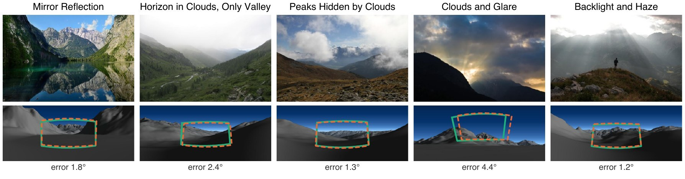
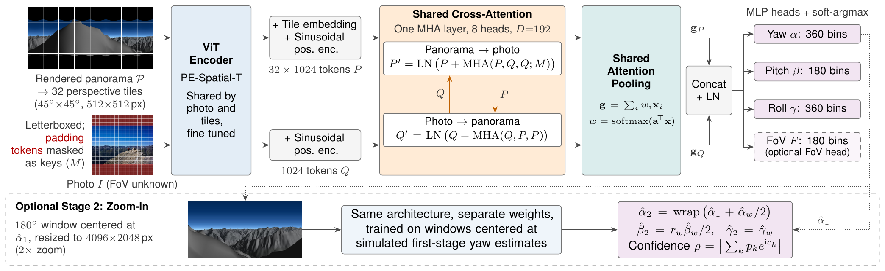
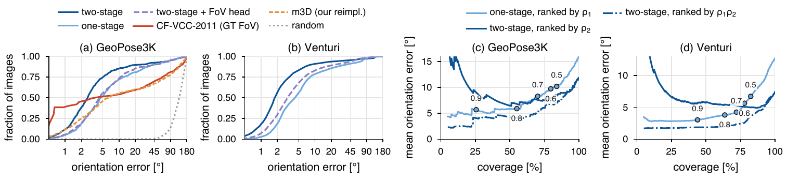

<h1 align="center">Photo2Pano</h1>

<p align="center">
  <b>Calibration-Free Cross-Modal Camera Orientation and Field-of-View Estimation<br>
  by Matching Photographs to Synthetic Panoramas</b>
</p>

<p align="center">
  <a href="#">Paper (TBD)</a> &nbsp;•&nbsp;
  <a href="https://cphoto.fit.vutbr.cz/photo2pano/">Project page &amp; dataset</a> &nbsp;•&nbsp;
  <a href="#trained-models">Trained models</a> &nbsp;•&nbsp;
  <a href="#citation">Citation</a>
</p>

<p align="center">
  
</p>
<p align="center"><sub>
  GeoPose3K test photos in difficult conditions (top) and the untextured panoramas rendered from a digital
  elevation model at their positions (bottom, cropped). Green: ground-truth outline; dashed orange: outline
  from the predicted orientation (two stages, drawn with the ground-truth FoV); below: orientation error.
</sub></p>

A geotag tells *where* a photo was taken, but not *where the camera was looking*. **Photo2Pano** takes a
photograph with **unknown intrinsics** and a 360° panorama rendered from a digital elevation model (DEM)
at the camera position, and predicts the camera **yaw, pitch and roll** and, optionally, the horizontal
**field of view (FoV)**, in a single forward pass and without any calibration information.

## Highlights

- **No FoV needed.** Classical photo-to-terrain pipelines take the FoV as input; Photo2Pano infers the scale
  of the photo in the panorama by attention.
- **Accurate where pipelines fail.** On the GeoPose3K test split, the mean/median orientation error is
  **11.9° / 2.6°**, compared with 39.3° / 3.5° for CF-VCC-2011 (given the ground-truth FoV), 41.4° / 6.3°
  for our reimplementation of the m3D silhouette matching and 63.6° / 48.5° for the best generic matcher.
- **Letterbox padding matters.** Without a mask, the cross-attention focuses on the black padding of resized
  photos; masking it as attention keys halves the one-stage median error (9.2° → 4.6° on GeoPose3K).
- **Zoom-in refinement.** An optional second stage re-estimates the orientation on a 2× magnified 180°
  window around the first-stage yaw, trained with simulated first-stage errors.
- **Fast.** 218 ms (first stage) + 607 ms (second stage) per query on an A100, 2.7 GB of GPU memory.

## Method

<p align="center">
  
</p>

The panorama is resampled into 32 perspective tiles at the native resolution of a small pretrained ViT
(PE-Spatial-T). The **same** encoder embeds the tiles and the photo, and their tokens interact in a single
cross-attention layer **shared by both directions**, in which the letterbox padding of the photo is masked
as keys. A shared attention pooling summarizes each modality, and MLP heads predict distributions over
angle bins, decoded by a circular soft-argmax; the spread of the yaw distribution serves as a confidence.
The optional second stage has the same architecture and refines the orientation on a zoomed-in window.

## Results

**GeoPose3K test split** (516 photos): orientation error over all photos and the fraction of photos below
each error threshold.

| Method | FoV given | Mean ↓ | Median ↓ | < 1° ↑ | < 5° ↑ | < 10° ↑ | < 20° ↑ |
|---|:---:|---:|---:|---:|---:|---:|---:|
| MatchAnything (best generic matcher) | – | 63.6° | 48.5° | 0.0% | 2.1% | 11.8% | 30.6% |
| m3D (our reimplementation) | – | 41.4° | 6.3° | 11.6% | 46.3% | 55.6% | 60.1% |
| CF-VCC-2011 | ground truth | 39.3° | 3.5° | **≈39%** | 51.6% | 54.1% | 59.5% |
| Photo2Pano, one stage | – | 16.0° | 4.6° | 5.2% | 51.9% | 72.1% | 81.0% |
| **Photo2Pano, two stages** | – | **11.9°** | **2.6°** | 11.8% | **74.8%** | **85.5%** | **89.7%** |

MatchAnything is the best of the generic matchers that we evaluated with their released weights
(DUSt3R, MASt3R, MatchAnything; see the paper). Below 1°, the FoV-aware pipelines remain more precise
(about 39% of the photos for CF-VCC-2011 and LandscapeAR); m3D, which does not receive the FoV, places
11.6% of the photos within 1°, on par with Photo2Pano (11.8%).

**Venturi** (12 video sequences, 3,117 frames): the two-stage model reaches **7.4° / 1.8°** (mean / median
over all frames), compared with a mean of 12.4° for CF-VCC-2011; the pipelines with m3D verification,
which receive the ground-truth FoV, remain more accurate (1.9°–2.9° mean).

**FoV estimation:** the optional FoV head reaches a median / mean FoV error of **5.4° / 7.7°** on
GeoPose3K, between fine-tuned GeoCalib (7.3° / 9.3°) and fine-tuned AnyCalib (4.5° / 5.3°), at the cost of
a higher orientation error.

<p align="center">
  
</p>
<p align="center"><sub>
  (a, b) Cumulative orientation error; on GeoPose3K (a) also m3D (our reimplementation) and CF-VCC-2011.
  (c, d) Mean error over the most confident fraction of the images.
</sub></p>

## Installation

```bash
git clone <repository-url>
cd <repository>
pip install -r requirements.txt
```

The encoder `timm/vit_pe_spatial_tiny_patch16_512.fb` is downloaded from the Hugging Face hub at the
first run. Inference needs about 2.7 GB of GPU memory and also runs on the CPU (slowly); training needs
one GPU with 40 GB (batch size 3, about 3 h per epoch on an A100).

## Quick start

Orientation (and optionally FoV) of a single photo, given the panorama rendered at its position:

```bash
python predict.py --photo photo.jpg --pano panorama.jpg \
    --stage1 weights/photo2pano_stage1_e80.pth --stage2 weights/photo2pano_stage2_e50.pth
```

Add `--fov-head` together with `--stage1 weights/photo2pano_stage1_fov_e80.pth` to also predict the FoV.

## Trained models

`weights/` contains the models of the paper (model parameters only, about 25 MB each; the `meta` entry of
each file names the training run and epoch):

| File | Model | GeoPose3K mean / median | Venturi mean / median |
|---|---|---:|---:|
| `photo2pano_stage1_e80.pth` | one stage, 80 epochs | 15.97° / 4.56° | 12.68° / 4.23° |
| `photo2pano_stage1_e80.pth` + `photo2pano_stage2_e50.pth` | two stages: the one-stage model followed by the second stage (50 epochs) | **11.90° / 2.62°** | **7.43° / 1.78°** |
| `photo2pano_stage1_fov_e80.pth` | one stage with FoV head, 80 epochs | 19.62° / 9.22° | 14.37° / 5.43° |

Orientation errors over all images (Venturi: all frames). The FoV head reaches a median / mean FoV error
of 5.40° / 7.65° on GeoPose3K.

## Data

Every sample consists of three files in one directory:

```
<name>_query.jpg      photo, resized to 512x512 px with preserved aspect ratio and black padding
<name>_panorama.jpg   cylindrical 360° panorama rendered at the camera position, 4096x2048 px canvas
<name>_gt.csv         one line: pitch, yaw, roll, horizontal FoV (degrees)
```

`preprocessing/geopose3k.py`, `preprocessing/landscapear.py` and `preprocessing/venturi.py` convert the
original datasets ([GeoPose3K](https://cphoto.fit.vutbr.cz/geoPose3K/), LandscapeAR, Venturi) into this
layout, given the rendered panoramas; `preprocessing/augment.py` writes the six augmented copies of every
training pair. `splits/` lists the samples used in the paper (augmented training and validation samples,
GeoPose3K test split, Venturi). The data are available on the [project page](https://cphoto.fit.vutbr.cz/photo2pano/).

## Evaluation

```bash
# one stage
python evaluate.py --data data/geopose_test --stage1 weights/photo2pano_stage1_e80.pth --out results/gp_1s.csv

# two stages (as in the paper)
python evaluate.py --data data/geopose_test --stage1 weights/photo2pano_stage1_e80.pth \
    --stage2 weights/photo2pano_stage2_e50.pth --out results/gp_2s.csv

# FoV head
python evaluate.py --data data/geopose_test --stage1 weights/photo2pano_stage1_fov_e80.pth --stage1-fov-head \
    --out results/gp_fov.csv
```

`--no-mask` evaluates without the padding mask. The csv contains one row per image with the predictions,
the confidences of both stages and all errors; the summary (mean and median over all images or frames,
accuracies, AUC, and for Venturi the mean of each sequence) is printed.

## Training

**First stage** (80 epochs):

```bash
torchrun --standalone --nproc_per_node=1 train.py --data data/train_aug --out checkpoints/stage1
torchrun --standalone --nproc_per_node=1 train.py --data data/train_aug --out checkpoints/stage1_fov --fov-head
```

**Second stage**: windows from the 8K renderings with simulated first-stage errors, trained from the
pretrained encoder for 50 epochs:

```bash
python build_stage2_dataset.py --in-dir data/train --pano-dir data/train_8k --out-dir data/train_s2 \
    --per-image 6 --augment --workers 8
torchrun --standalone --nproc_per_node=1 train.py --data data/train_s2 --out checkpoints/stage2 --epochs 50
```

`--init <checkpoint> --lr 3e-5 --lr-backbone 3e-6` fine-tunes from a first-stage checkpoint instead.
`--offset-mode empirical --errors-csv <csv>` builds the windows from measured first-stage errors.

## Attention maps

```bash
python -m tools.attention --data data/geopose_test --ckpt weights/photo2pano_stage1_e80.pth --random 40 --out stats.npz
```

<details>
<summary><b>Repository structure</b></summary>

```
photo2pano/
  model.py      OrientationEstimator (optional FoV head, attention maps)
  angles.py     angle bins, circular soft-argmax, confidence, geodesic rotation error
  losses.py     circular Huber loss, FoV loss
  padding.py    padding mask of letterboxed photos
  window.py     second-stage window and conversion of its angles
  offsets.py    simulated first-stage yaw errors for training the second stage
  data.py       dataset
train.py                  training of the first or the second stage
build_stage2_dataset.py   training windows with simulated first-stage errors
evaluate.py               one- and two-stage evaluation on a dataset directory
predict.py                orientation (and FoV) of a single photo
preprocessing/            GeoPose3K, LandscapeAR and Venturi conversion, offline augmentation
tools/attention.py        attention maps and padding statistics
splits/                   base names of the training, validation and test samples used in the paper
weights/                  trained models of the paper
assets/                   figures of this README
```

</details>

## Citation

```bibtex
@inproceedings{photo2pano,
  TODO
}
```

## License

The code and the trained models in `weights/` are released under the [Apache License 2.0](LICENSE).
The models are fine-tuned from the PE-Spatial-T encoder of the
[Perception Encoder](https://github.com/facebookresearch/perception_models), which is also released under
Apache 2.0. 
The dataset (photos, splits and rendered panoramas) is distributed separately under its own
license; see the [project page](https://cphoto.fit.vutbr.cz/photo2pano/).
